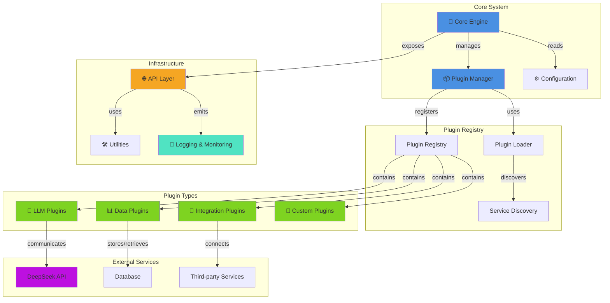

# DeepSeek Harness Architecture

## Overview

DeepSeek Harness is built on a plugin-based architecture where every component is a plugin. This design enables modularity, extensibility, and loose coupling between system components.

## Architecture Diagram



## Core Components

### 1. **Core Engine**
The central runtime that orchestrates plugin execution and lifecycle management.

### 2. **Plugin Manager**
Responsible for:
- Loading and unloading plugins
- Managing plugin lifecycle (init, start, stop)
- Handling plugin dependencies
- Coordinating plugin communication

### 3. **Plugin Registry**
Central registry that:
- Maintains active plugins
- Provides plugin metadata
- Enables service discovery
- Tracks plugin versions and capabilities

### 4. **Configuration System**
Manages:
- System-wide configuration
- Plugin-specific settings
- Environment variables
- Runtime parameters

## Plugin Types

### LLM Plugins
- Integration with DeepSeek API
- Model selection and routing
- Prompt engineering and optimization

### Data Plugins
- Database operations
- Caching strategies
- Data transformation and validation

### Integration Plugins
- Third-party service connections
- API clients and SDKs
- Webhooks and event handling

### Custom Plugins
- User-defined extensions
- Business logic implementations
- Domain-specific functionality

## Technology Stack

- **Language**: TypeScript (97.4%)
- **Styling**: CSS (1.4%)
- **Scripting**: Python (0.7%), Shell (0.1%)
- **Performance**: C (0%)

## Key Features

✨ **Modularity** - Each plugin is self-contained and independent  
🔌 **Extensibility** - Easy to add new plugins without modifying core  
🔄 **Hot Reloading** - Plugins can be loaded/unloaded at runtime  
📡 **Inter-Plugin Communication** - Built-in messaging between plugins  
🛡️ **Isolation** - Plugins run in isolated contexts  
⚡ **Performance** - TypeScript provides type safety and optimization opportunities  

## Plugin Development Workflow

```
Create Plugin → Register in System → Load via Plugin Manager → Execute via Core Engine
```

## Communication Patterns

- **Event-Driven**: Plugins emit and listen to system events
- **Request-Response**: Synchronous plugin-to-plugin calls via Registry
- **Message Queue**: Asynchronous communication for long-running operations
- **Middleware Chain**: Plugins can wrap and enhance other plugin functionality

---

*Last Updated: 2026-08-29*
